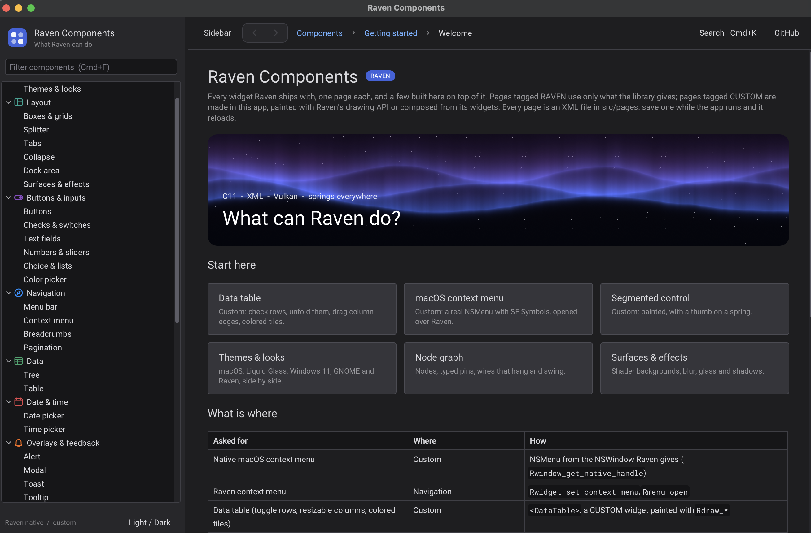
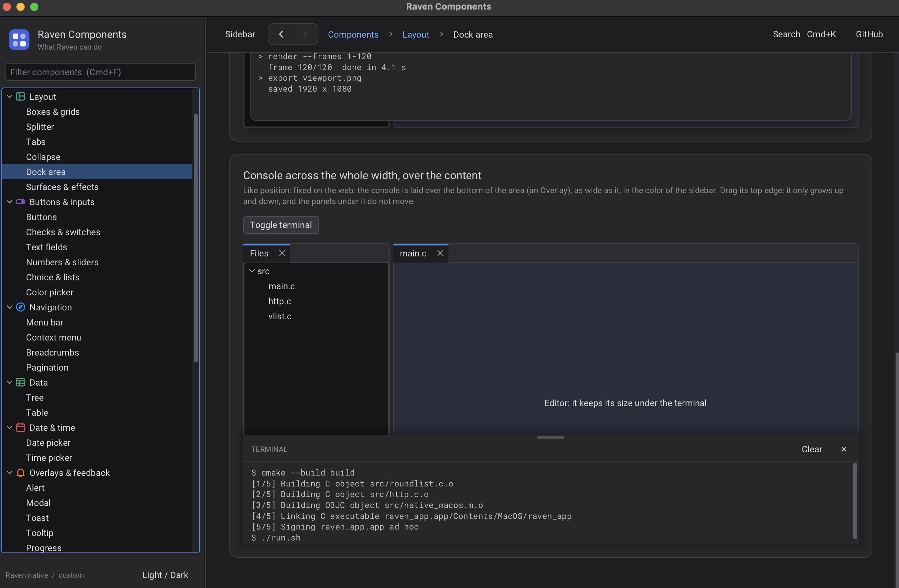
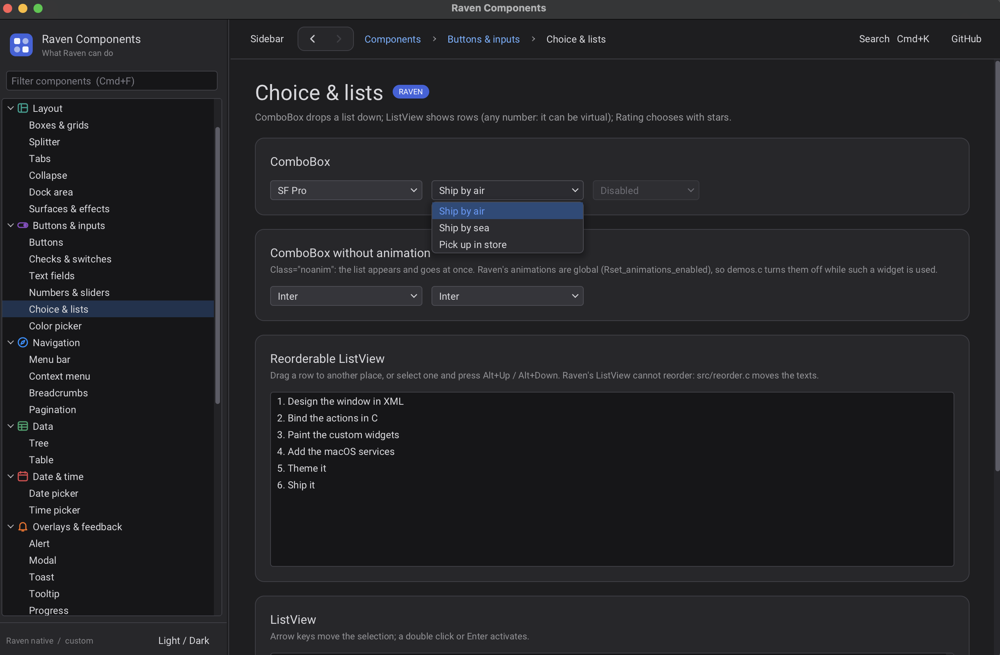

# Raven Components

A gallery app that shows what [Raven](https://github.com/oscar-soirey/Raven) (a lightweight GUI library in C) can do. Each component has its own page, and the ones Raven doesn't ship are built here on top of it and listed in a separate **Custom** section.



## Build

Raven is a git submodule, so clone with `--recursive`:

```sh
git clone --recursive https://github.com/GiorgiKumelashvili/gui-c-raven-examples.git
cd gui-c-raven-examples
```

Already cloned without it?

```sh
git submodule update --init --recursive
```

**Requirements (macOS):**

- Xcode command line tools: `xcode-select --install`
- CMake: `brew install cmake`
- Vulkan through MoltenVK: `brew install molten-vk`
- Internet on the first configure (Raven downloads the Vulkan headers)

The macOS-only features (native context menu, Finder panels, notifications, live resize) are compiled on macOS only. On other systems the app falls back to Raven's own widgets where it can.

## Run

```sh
./run.sh
```

This configures and builds into `build/` when needed, then starts the app. On macOS it is built as an app bundle (`build/raven_app.app`) because notifications only work for bundles.

Pages are XML files in `src/pages/`: save one while the app is running and the window reloads.

Optional environment variables for debugging:

| Variable | Effect |
|---|---|
| `APP_PAGE=custom.datatable` | Open on that page |
| `APP_THEME=MacOSLight` | Start with another look |
| `APP_SHOT=/tmp/x.tga` | Save a screenshot of the window and quit |

## Examples

Pages tagged **RAVEN** use only what the library provides. Pages tagged **CUSTOM** are made in this app, either painted with Raven's drawing API or composed from its widgets.





| Section | Pages |
|---|---|
| Getting started | Welcome, Themes & looks (macOS, Liquid Glass, Windows 11, GNOME, Raven) |
| Layout | Boxes & grids, Splitter, Tabs, Collapse, Dock area, Surfaces & effects |
| Buttons & inputs | Buttons, Checks & switches, Text fields, Numbers & sliders, Choice & lists, Color picker |
| Navigation | Menu bar, Context menu, Breadcrumbs, Pagination |
| Data | Tree, Table |
| Date & time | Date picker, Time picker |
| Overlays & feedback | Alert, Modal, Toast, Tooltip, Progress |
| Text & code | Typography & Markdown, Code editor |
| Tools | Node graph, Timeline |
| **Custom** | macOS context menu (NSMenu), Finder file panels, macOS notifications, Data table, Button group, Segmented control, Popover, Omni bar (Cmd+K), File input, Plain textarea, Virtual list (1M rows), Canvas, Accordion (native and neobrutalism), Simple HTTP, Scroll speeds, Windows & shared state |

Where to find the code:

- `src/main.xml`: the window (menu bar, sidebar, page switcher)
- `src/widgets.xml`: tags declared in XML (`Page`, `Demo`, `ButtonGroup`, `FileInput`, ...)
- `src/pages/*.xml`: one file per page
- `src/*.c`, `src/*.m`: custom widgets and native services (`datatable.c`, `segmented.c`, `popover.c`, `omnibar.c`, `native_macos.m`, ...)

## License

This repository has no license file yet. Raven has its own license: see `third_party/Raven/LICENSE`.
